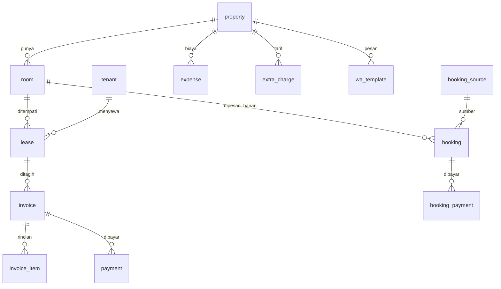

# Damar Kost — Rencana Teknis PWA (Draft v0.1)

> Tanggal: 15 Nov 2026 · Mengacu ke [01-PRD.md](01-PRD.md) dan [02-DESIGN-CONCEPT.md](02-DESIGN-CONCEPT.md)
> Batasan utama: **1 pengguna (pemilik)**, **9 kamar**, **hanya iPhone**, dikembangkan di **Windows (tanpa Mac)**.

---

## 1. Ringkasan keputusan

| Area | Pilihan | Alasan singkat |
|---|---|---|
| Bentuk aplikasi | **PWA** (dipasang dari Safari → "Tambahkan ke Layar Utama") | Tanpa App Store, tanpa Mac, tanpa biaya Apple Developer. Update cukup deploy ulang. |
| Frontend | **React + TypeScript + Vite** + `vite-plugin-pwa` | Cepat, ringan, ekosistem PWA matang. |
| Gaya/UI | CSS variables (token dari desain) + Tailwind v4 *atau* CSS Modules | Token terang/gelap sudah ada di mockup → tinggal dipindahkan. |
| Data & login | **Supabase** (Postgres + Auth + Storage + cron) | Data kos itu relasional (kamar ↔ penghuni ↔ tagihan ↔ bayar); SQL lebih pas daripada NoSQL. Hampir tanpa server sendiri. |
| Hosting | **Cloudflare Pages / Vercel / Netlify** (gratis) | HTTPS otomatis (wajib untuk PWA), deploy dari Git. |
| Pengingat WA | Link `wa.me` dengan pesan terisi | Gratis, tidak butuh WhatsApp Business API (Fase 3). |
| Ekspor | PDF & Excel dibuat **di HP** (client-side) | Tanpa server tambahan; hasilnya bisa langsung dibagikan via Share Sheet iPhone. |

Alternatif yang dipertimbangkan: **Firebase** (Firestore) — bagus untuk realtime, tapi query laporan (jumlah per bulan, per kategori, tunggakan) lebih repot tanpa SQL. **Expo/React Native** — butuh akun Apple Developer (± USD 99/tahun) untuk memasang ke iPhone; tidak sepadan untuk 1 pengguna.

---

## 2. Arsitektur

```
 iPhone (Safari / PWA terpasang)
 ┌──────────────────────────────────────┐
 │ React app (offline shell via SW)     │
 │  ├─ TanStack Query (cache + IndexedDB)│
 │  ├─ PIN lokal (WebCrypto)            │
 │  └─ PDF/Excel, Web Share, wa.me link │
 └──────────────┬───────────────────────┘
                │ HTTPS (supabase-js)
 ┌──────────────▼───────────────────────┐
 │ Supabase                             │
 │  ├─ Auth (email+password, signup OFF)│
 │  ├─ Postgres + Row Level Security    │
 │  ├─ Storage (bucket privat: KTP, nota│
 │  │   bukti transfer)                 │
 │  └─ pg_cron: buat tagihan & denda    │
 └──────────────────────────────────────┘
```

**Prinsip:** logika uang (membuat tagihan, menghitung denda/prorata, status telat) ada di **database** (SQL function + cron), bukan di HP — supaya angka selalu konsisten walau aplikasi lama tidak dibuka.

---

## 3. Struktur data

Uang disimpan sebagai **bilangan bulat Rupiah** (`bigint`), tanggal pakai zona **Asia/Jakarta**. Data keuangan **tidak pernah dihapus**, hanya dibatalkan (`voided_at` + alasan).



| Tabel | Kolom penting | Catatan |
|---|---|---|
| `property` | name, address, bank_account, billing_mode (`per_entry`/`fixed`), fixed_day, prorata, late_fee_enabled, grace_days, late_fee_per_day | 1 baris saja (1 kos) |
| `room` | code (`101`), floor, label (keterangan opsional; semua kamar ber-AC), base_price, **rent_mode** (`monthly`/`daily`/`both`), **nightly_price**, weekend_price, facilities[], under_repair, repair_note, needs_cleaning | Status Kosong/Terisi **dihitung** dari `lease` aktif atau `booking` malam ini. `rent_mode` diubah sendiri oleh pemilik. |
| `booking` | room_id, guest_name, guest_phone, guests_count, check_in, check_out (eksklusif), nights (generated), nightly_rate, total, source_id, commission_pct, commission_amount, dp_amount, paid_status (`unpaid`/`dp`/`paid`), status (`booked`/`checked_in`/`checked_out`/`cancelled`), ktp_path, note | **Constraint anti-bentrok:** `EXCLUDE USING gist (room_id WITH =, daterange(check_in, check_out) WITH &&) WHERE status <> 'cancelled'` |
| `booking_source` | name, default_commission_pct, color, active | Daftar diedit sendiri (Langsung, Walk-in, Airbnb, Traveloka, …) |
| `booking_payment` | booking_id, amount, paid_at, method, voided_at | Pembayaran tamu homestay (DP/pelunasan) |
| `tenant` | full_name, phone, job, hometown, emergency_name/phone, ktp_path, archived_at, delete_personal_after | Arsip, bukan hapus |
| `lease` | tenant_id, room_id, start_date, end_date, rent_price, due_day, deposit_amount, deposit_status (`held`/`refunded`/`deducted`), deduction_amount/reason, checkout_date | Pindah kamar = lease lama ditutup, lease baru dibuat |
| `invoice` | lease_id, period (bulan), due_date, total, status (`unpaid`/`partial`/`paid`/`void`) | Dibuat otomatis oleh cron |
| `invoice_item` | invoice_id, kind (`rent`/`extra`/`late_fee`/`prorata`), label, amount | |
| `payment` | invoice_id, amount, paid_at, method (`cash`/`transfer`/`qris`), proof_path, voided_at, void_reason | "Urungkan" = isi `voided_at` |
| `expense` | date, category, amount, note, receipt_path, voided_at | |
| `extra_charge` | name, amount, unit (`month`/`night`/`kg`) | Parkir, tamu menginap, laundry |
| `wa_template` | key (`h3`/`h0`/`late`/`receipt`), lang (`id`/`en`), body | Variabel `{nama}`, `{kamar}`, … |
| `audit_log` | table_name, row_id, action, detail, at | Jejak pembatalan/perubahan uang |

**View** untuk layar: `v_room_status` (rumah ilustrasi), `v_dashboard_month` (pemasukan, target, belum bayar), `v_expense_by_category`, `v_income_by_room`.

**Keamanan (RLS):** semua tabel hanya bisa dibaca/ditulis oleh `auth.uid()` milik pemilik. Pendaftaran akun baru **dimatikan** di Supabase; akun pemilik dibuat sekali lewat dashboard.

---

## 4. Aturan bisnis → implementasi

| Aturan (PRD §6) | Di mana | Cara |
|---|---|---|
| Tagihan bulanan otomatis | `pg_cron` harian 00:05 WIB | Fungsi `generate_invoices(today)`: buat invoice periode berjalan untuk lease aktif yang belum punya (idempoten). |
| Mode per tanggal masuk / serentak | Fungsi yang sama | `due_date` = `due_day` lease, atau `fixed_day` properti. |
| Prorata bulan pertama | Saat lease dibuat | `invoice_item kind=prorata` = sewa × sisa hari / jumlah hari bulan itu. |
| Denda telat | `pg_cron` harian | Jika `today > due_date + grace_days` & belum lunas → tambah/perbarui item `late_fee`. |
| Status Telat / Jatuh tempo | View | Dihitung dari `due_date` vs hari ini (tidak disimpan). |
| Deposit bukan pemasukan | Laporan | Deposit di `lease`, tidak dijumlah ke pemasukan. |
| Kenaikan harga | `room.base_price` | Hanya memengaruhi lease/invoice **baru**. |
| Batal/urungkan bayar | `payment.voided_at` | Status invoice dihitung ulang via trigger; tercatat di `audit_log`. |
| Homestay tidak boleh dobel | Constraint `EXCLUDE` di `booking` | Database menolak pesanan yang tanggalnya tumpang tindih di kamar sama. |
| Kamar `daily` tanpa tagihan bulanan | `generate_invoices` | Hanya lease di kamar `monthly`/`both`. Kamar `both` yang punya lease aktif tidak bisa dipesan harian. |
| Pemasukan homestay | View `v_income_month` | Dihitung per **malam** yang jatuh di bulan itu (pesanan 30 Nov–2 Des terbagi 2 bulan), dikurangi komisi. |
| Perlu dibersihkan | Saat check-out | `room.needs_cleaning = true` sampai ditandai bersih. |

---

## 5. Hal khusus iPhone (PWA)

| Topik | Yang harus dilakukan |
|---|---|
| Ikon & nama | `manifest.webmanifest` (name "Damar Kost", `display: standalone`, theme/background color) **+ `apple-touch-icon` 180×180 PNG** (iOS memakai ini, bukan ikon manifest). Sumber: `brand/damar-kost-icon.svg` → ekspor PNG. |
| Cara pasang | iOS tidak punya tombol "Install" otomatis → buat layar panduan **"Pasang ke Layar Utama"** (Share → Tambahkan ke Layar Utama), tampil saat dibuka di Safari biasa (`navigator.standalone === false`). |
| Layar penuh & notch | `viewport-fit=cover`, padding `env(safe-area-inset-*)`, tinggi pakai `100dvh`; tab bar melayang di atas *home indicator*. |
| Input | `font-size ≥ 16px` agar Safari tidak zoom; `inputmode="numeric"` untuk Rupiah; `type="tel"` untuk no. HP. |
| Kamera | `<input type="file" accept="image/*" capture="environment">` untuk foto nota/KTP; kompres di HP (maks ±1600px, JPEG 0.7) sebelum upload. |
| Notifikasi (Fase 2) | Web Push hanya jalan bila sudah dipasang ke Layar Utama (iOS 16.4+) dan izin diberikan dari tombol di aplikasi. |
| Offline | Service worker menyimpan *app shell*; data terakhir dari cache TanStack Query (IndexedDB). Fase 1: **lihat** saat offline; Fase 2: antrean catat-bayar offline. |
| Berbagi | Web Share API untuk kirim PDF kuitansi/laporan ke WhatsApp. |
| Uji | Wajib uji di **WebKit** (Playwright `webkit`, viewport iPhone) + di iPhone asli sebelum rilis. |

---

## 6. Login, PIN, dan privasi

- **Login**: email + kata sandi (Supabase Auth). Sesi disimpan → tidak perlu login ulang setiap buka.
- **Lupa kata sandi**: lewat **email** reset dari Supabase. *(Mockup menyebut "email atau WhatsApp" — kode via WA butuh penyedia berbayar; disarankan email saja di MVP, mockup disesuaikan.)*
- **Kunci PIN**: murni di HP. PIN di-*hash* (WebCrypto PBKDF2) di IndexedDB; diminta saat aplikasi dibuka setelah idle > X menit. Lupa PIN → login ulang dengan kata sandi. Opsi Face ID (passkey/WebAuthn) bisa ditambah nanti.
- **KTP & bukti**: bucket Storage **privat**, akses lewat *signed URL* berumur pendek (±60 detik); foto KTP hanya dimuat saat tombol "Lihat" ditekan. Sesuai UU PDP: penghapusan data pribadi penghuni arsip setelah 1 tahun (tombol + pengingat).

---

## 7. Struktur proyek

```
koscemara/
├─ app/                      # PWA (Vite + React + TS)
│  ├─ public/                # ikon, apple-touch-icon, manifest
│  └─ src/
│     ├─ design/             # token warna terang/gelap, font, komponen dasar
│     ├─ features/
│     │  ├─ home/            # Beranda + rumah ilustrasi
│     │  ├─ rooms/  tenants/  bills/  expenses/  reports/  settings/  auth/
│     ├─ lib/                # supabase client, format Rupiah/tanggal, wa-link, pdf, xlsx
│     └─ i18n/               # id.json, en.json
├─ supabase/
│  ├─ migrations/            # skema, RLS, view, fungsi
│  └─ seed.sql               # 9 kamar + data contoh (untuk dev)
├─ brand/                    # logo & ikon SVG
└─ docs/
```

Pustaka inti: `react-router`, `@tanstack/react-query` (+ persist ke IndexedDB), `@supabase/supabase-js`, `react-hook-form` + `zod`, `date-fns` (locale `id`), `lucide-react`, `xlsx` (SheetJS) dan `pdfmake`/`@react-pdf/renderer`, `i18next` (atau kamus sederhana).

---

## 8. Tahapan pengerjaan (perkiraan 1 developer)

| Tahap | Isi | Perkiraan | Selesai bila… |
|---|---|---|---|
| **M0 · Fondasi** | Repo, Vite PWA, token desain, Supabase (skema + RLS + seed), login, deploy otomatis | 2–3 hari | Bisa login di iPhone & aplikasi terpasang di Layar Utama |
| **M1 · Kamar & penghuni** | Beranda + rumah ilustrasi, tab Kamar, penghuni baru, profil, pindah kamar, check-out + deposit | 4–5 hari | 9 kamar & penghuni nyata sudah diinput |
| **M2 · Tagihan & bayar** | Cron tagihan, daftar Tagihan, catat bayar (≤3 ketukan) + Urungkan, pengingat & kuitansi WA, template WA | 4–5 hari | Satu siklus bulan tertagih & tercatat benar |
| **M2b · Homestay** | Jenis sewa per kamar, kalender 14 hari, pesanan + sumber/komisi, check-in/out, status bersih, WA konfirmasi | 3–4 hari | Pesanan bentrok ditolak; kalender & rumah ilustrasi akurat |
| **M3 · Pengeluaran & laporan** | Catat pengeluaran + foto nota, Laporan bulanan (kos vs homestay), ekspor PDF/Excel | 3 hari | Laporan cocok dengan hitungan manual |
| **M4 · Rapikan** | Mode gelap, ID/EN, PIN, panduan pasang, cache offline, uji WebKit + iPhone asli | 3 hari | Lolos daftar uji di §9 |
| **Beta** | Dipakai pemilik dengan data asli 1–2 minggu, perbaikan | 1–2 minggu | Pemilik tidak lagi pakai buku/Excel |

Total MVP: **± 4–5 minggu kerja** (termasuk homestay) + masa beta.

---

## 9. Pengujian

- **Unit (Vitest):** format Rupiah, hitung prorata & denda, isi template WA, perhitungan laporan.
- **Database:** tes fungsi `generate_invoices` & denda (idempoten, akhir bulan, Februari, kabisat, masuk tgl 31).
- **E2E (Playwright, WebKit + viewport iPhone):** login → catat bayar → urungkan → laporan berubah; penghuni baru → tagihan pertama prorata; check-out → kamar Kosong.
- **Manual di iPhone:** pasang ke Layar Utama, notch/safe area, kamera, mode gelap sistem, kirim WA, bagikan PDF.

---

## 10. Biaya & risiko

| Item | Biaya | Catatan |
|---|---|---|
| Hosting frontend | Gratis | Cloudflare Pages / Vercel / Netlify |
| Supabase | Gratis (tier Free) atau berbayar (tier Pro) | **Cek ulang saat setup:** di tier Free, proyek yang tidak aktif beberapa hari bisa dijeda & backup otomatis terbatas. Pemakaian harian biasanya cukup menjaga tetap aktif. |
| Domain (opsional) | ± puluhan–ratusan ribu Rp/tahun | Mis. `damarkost.my.id`; tanpa domain pun bisa pakai subdomain gratis hosting |
| WhatsApp | Gratis | Link `wa.me`; otomatis (Business API) baru Fase 3 |

| Risiko | Mitigasi |
|---|---|
| Data hilang (tanpa backup berbayar) | Ekspor otomatis mingguan (GitHub Action `pg_dump` ke penyimpanan privat) + tombol "Ekspor semua data" di aplikasi |
| Proyek Supabase dijeda | Pemakaian rutin; atau ping terjadwal; atau naik ke tier berbayar bila perlu |
| Perilaku PWA iOS berubah | Data utama di server, bukan hanya di HP; uji tiap update iOS besar |
| Lupa kata sandi & email tidak bisa diakses | Simpan email pemulihan kedua di Supabase; developer bisa reset dari dashboard |

---

## 11. Perlu keputusan sebelum mulai M0

1. **Email akun pemilik** (untuk login & reset kata sandi).
2. **Nama domain** — pakai domain sendiri atau subdomain gratis dulu?
3. **Data awal** — ada catatan lama (buku/Excel) yang perlu dimasukkan? Kalau Excel, bisa dibuat impor sekali jalan.
4. **Lupa kata sandi via email saja** untuk MVP (mockup disesuaikan) — setuju?
5. **Siapa yang memelihara** (update, backup) setelah rilis — Anda sendiri?
